  

  
  
  
  
  

  

I build and maintain production iOS apps in Swift with **UIKit** and **SwiftUI**. My work covers feature development, push notifications, payments, Bluetooth devices, offline storage, and the part that rarely shows in screenshots: finding the leak, the race, or the slow screen in a codebase someone else started.

## Production work

Client apps at [MLBench](https://github.com/MLBenchPvtLtd). The source is private; the cards describe my own work on each.

  
  

  
  

  

## Under the hood

Real commits from Fikar. Memory leaks, data races and duplicated code, found and fixed.

  

## How I build from scratch

  

Ten Swift Package modules, Core Data behind repository protocols, a CoreBluetooth heart-rate parser, and a Vapor and PostgreSQL back end with JWT authentication.

## More apps

| App | Where | What I did |
| --- | --- | --- |
| **Koy** | MLBench · App Store | Fixed push delivery, Firebase phone auth, Apple and Google sign-in, and nearby discovery. Added state-driven pulse animations. |
| **Lumashape** | MLBench · App Store | Input validation, original and segmented image upload, image orientation and unit fixes. |
| **Sketch Anime** | 3TechSoft | Photo-to-sketch with Core Image in a UIKit codebase, cancellable background processing, iPad layouts, ATT and SKAdNetwork. |

## Open source

| Project | Built with | What it shows |
| --- | --- | --- |
| [**Movies Browser**](https://github.com/Dawoodakbar/BroswersApp) | UIKit · Core Data · URLSession | Compositional layouts, search, pagination, offline favorites, NSCache images |
| [**Dex**](https://github.com/Dawoodakbar/Dex) | SwiftUI · Core Data · WidgetKit | Offline-first Pokédex with a home screen widget |
| [**FireLime**](https://github.com/Dawoodakbar/FireLime) | SwiftUI · Firebase | Real-time group chat with Apple and Google sign-in |
| [**HP Trivia**](https://github.com/Dawoodakbar/Hp-Trivia) | SwiftUI · StoreKit · AVKit | Quiz game with in-app purchases |
| [**CueSense**](https://github.com/Dawoodakbar/CueSense.swiftpm) | SwiftUI · SwiftData · Speech | On-device social-cue assistant |
| [**BBQuotes**](https://github.com/Dawoodakbar/BBQuotes) | SwiftUI · async/await | Quotes and characters from a REST API |

## Toolbox

  

**iOS** Swift · UIKit · SwiftUI · Combine · Core Data · SwiftData · Core Animation · Core Graphics · CoreBluetooth · Core Image · StoreKit 2 · WidgetKit  
**Concurrency** async/await · actors · GCD · cancellable tasks · leak, retain-cycle and data-race fixes  
**Integrations** Firebase Cloud Messaging · Firebase Auth and Firestore · Apple Pay · Sign in with Apple · Google Sign-In · Socket.IO  
**Quality** MVVM · Clean Architecture · Coordinator · dependency injection · XCUITest · Swift Testing · SwiftLint
